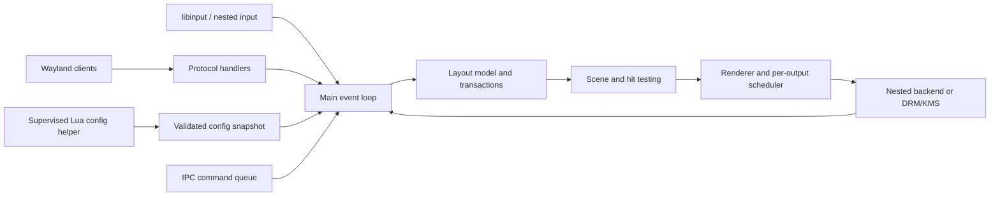

# Rust architecture

This is a proposed architecture. Smithay provides library building blocks; the modules below are FluxWM responsibilities. Read [Smithay's introduction](https://github.com/Smithay/smithay) and [Calloop](https://github.com/Smithay/calloop) for the upstream integration model.

## Workspace structure

| Proposed crate | Responsibility | Must not own |
| --- | --- | --- |
| `fluxwm` | Executable, startup, session lifecycle, backend selection | Layout algorithms |
| `flux-core` | IDs, commands, events, configuration snapshot, shared value types | Wayland objects, GPU handles |
| `flux-layout` | Pure strip/canvas model, constraints, focus navigation, transactions | Event loop, Lua, file I/O |
| `flux-scene` | Scene graph, transforms, clips, visibility, hit testing | Protocol resource ownership |
| `flux-render` | Render elements, effects, damage, output scheduling | Window placement policy |
| `flux-backend` | Nested and DRM implementations, session and device discovery | User rules |
| `flux-protocols` | Wayland handlers, surface tree state, protocol validation | Arbitrary layout mutation |
| `flux-config` | Config helper protocol, typed schema, diagnostics, generation handling | Frame callbacks |
| `fluxwm-config` | Supervised Lua evaluation process; bounded input/output | Main compositor state and device handles |
| `flux-ipc` | Versioned commands/events, bounded sockets | Unchecked access to GPU resources |
| `fluxctl` | CLI parsing and IPC client | Compositor process state |
| `flux-test-support` | Fake clock, fake clients, deterministic replay | Production launch code |

Start with a few modules rather than creating every crate before interfaces are known. Extract pure layout and shared types first; split integrations when it improves dependency boundaries. Avoid a public plugin ABI in version 1.

## Ownership and threading

Use one authoritative event-loop thread for Wayland objects, focus, layout mutations, seat state, backend lifecycle, and initially rendering. GPU contexts remain on their required thread. Worker threads handle asset decoding and bounded diagnostic processing. Lua configuration runs in a supervised helper process with a parent-enforced deadline; a thread cannot be safely killed to enforce a hard timeout. Workers return immutable data or typed commands. They cannot mutate surfaces or hold mutable compositor references.

Use stable generational IDs for windows, workspaces, outputs, scene nodes, and jobs. A command for an old generation fails without touching a reused object. Keep protocol IDs separate from persistent user IDs. Make dependencies explicit through subsystem methods instead of a global mutable registry.

The Rust state can conceptually contain `ServerState`, `SeatState`, `LayoutState`, `SceneState`, `OutputState`, `ConfigSnapshot`, `TransactionQueue`, and `Diagnostics`. These are design names, not existing APIs. Store client-owned resources in protocol state; layout holds IDs and metadata rather than cloning protocol ownership into every tile.

## Event processing

1. Dispatch ready I/O with fairness limits per source. Validate client requests before creating internal commands.
2. Apply high-priority session/lock/device events before ordinary user actions.
3. Translate input, IPC, rules, and protocol requests into typed commands.
4. Mutate the authoritative model once per bounded batch, recording changed windows/outputs.
5. Resolve layout constraints and issue required configure requests without waiting.
6. Update transactions and sample animations at a monotonic time.
7. Build the scene for each affected output, using the same transforms for drawing and picking.
8. Schedule frames only for damage, animation, output changes, cursor work, or active capture.
9. Handle completion events, release resources at their actual safe lifetime, deliver presentation information, and retire old transactions.

Bound client dispatch and command queues so a flooding client does not starve lock handling or page flips. Coalesce repeated camera deltas and configuration notifications, preserving ordering for key events and lifecycle transitions. Use a monotonic clock; wall-clock adjustments must not move animation time backwards.

## Commands, events, and transactions

Commands express intent: `FocusDirection`, `MoveWindow`, `PanCamera`, `SetWorkspaceMode`, `ApplyConfig`, `SetOutputConfig`, `BeginLock`. Events describe committed results and include a monotonically increasing state sequence. Input and IPC use the same command validation. Lua bindings compile to these commands.

A resize transaction includes an epoch, intended rectangles, configure serials for changed clients, readiness, and deadline. A client may commit intermediate state or never respond. Present the last valid buffer with an explicit scale/clip policy while waiting, then finish at deadline without blocking unrelated clients. Reconcile late buffers with the current epoch; never let an obsolete configure restore an old layout. Keep serial handling compliant with xdg-shell rather than inventing a one-configure/one-commit assumption.

Closing/unmapping removes input eligibility immediately. An optional closing snapshot has independent retained resources with a deadline and no focus target. Explicit sync release must still wait until every actual consumer has finished; a snapshot cannot justify prematurely releasing its source buffer.

## Dependencies and builds

Choose Rust stable and edition during phase 1; record MSRV and a pinned `rust-toolchain.toml`. Select Smithay release or exact Git revision after checking needed fixes. Commit `Cargo.lock` for the executable. Align `wayland-server`, protocol bindings, Calloop, and Smithay's compatible dependency graph instead of choosing independent latest versions.

Candidate supporting crates: `mlua` with Lua 5.4 and serialization support; `serde`/`serde_json` for schemas/IPC; `tracing` for structured diagnostics; `thiserror` for recoverable errors; a property-testing crate for pure state models. Exact versions and features remain phase 1 deliverables. Inspect system library requirements for DRM, GBM, EGL/GLES, libinput, libudev, libseat, and xkbcommon using the selected upstream revision.

Use feature groups for nested development, DRM hardware, X11 integration, and diagnostics. Compile the smallest nested target in CI; separately compile every supported production feature combination. Rust memory safety does not remove FFI, protocol, or GPU lifetime hazards. Every new `unsafe` block needs a local invariant and review.

## Failure policy

| Failure | Required response |
| --- | --- |
| Invalid client request | Protocol-defined client error; isolate to that client |
| Unresponsive client | Keep compositor responsive; mark stalled, allow close |
| Bad config | Keep last valid generation; report path/field/line where available |
| Output removed | Move workspaces atomically; cancel stale output jobs |
| Session inactive | Stop device access/render commits until reacquired |
| Portal or X11 helper crash | Stop affected feature, report and optionally restart helper |
| GPU import failure | Reject invalid path; use supported negotiated fallback where possible |
| GPU reset | Recreate safe resources if viable; otherwise restore session control and exit cleanly |

A persistent layout snapshot stores workspace names, stable output hints, camera positions, and app matching hints. It must not claim to preserve live Wayland connections after a compositor crash. Avoid automatic focus assignment solely by untrusted app IDs during restoration.

## Production ordering additions

[State machines](14-state-machines.md) distinguish layout readiness, buffer acquire readiness, and consumer completion. [Resource policy](17-resource-security.md) defines bounded admission and helper lifetime. Output/config/surface generations are distinct. Use the scene snapshot associated with the relevant visible presentation for input picking; do not pick against an unpresented future animation sample. Nested backends must document the strongest presentation timing they can observe rather than invent page-flip certainty.

Configure serials use protocol/library wrap-aware handling. A layout timeout may show an older valid buffer but never bypasses GPU acquire. An IPC or config action passes the same lock/privilege checks as device input. Privileged helper identity derives from trusted connection provenance, not app metadata.
